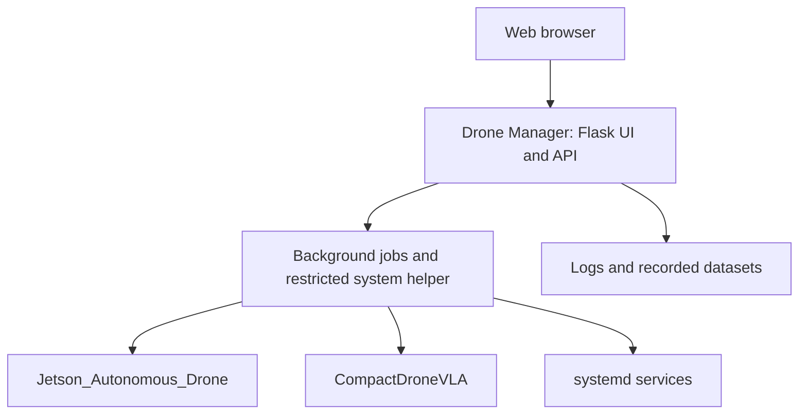

## So someday I might like to build a flask UI that can allow me to use a web browser to install and configure the software in the Jetson_Autonomous_Drone folder and the CompactDroneVLA folder. The flask UI would allow me to install either the Auto_Drone service that is in the Jetson_Autonomous_Drone folder, the VLA Autonomous Servcice in the CompactDroneVLA folder, or the Data collection service in the CompactDroneVLA folder. I can view and download the data collected from the data collection service, read logs, change ENV file settings that control the drone, etc... How would I go about doing this? It would probably be better to just make a separate Github repository that can then download both autonomous drone projects and read them. So I'd have 3 github repos working together and this wouild allow the code to be more modular

Yes—a **third repository for a drone management UI** would be a good fit. Keep the flight and recording software in their current repositories, and let the new project handle installation, configuration, service management, logs, and downloads.

I inspected both local projects. Much of the underlying functionality already exists; the main work would be giving it a consistent management interface.

**I would run the manager on the Jetson**, with your laptop or phone connecting through a browser:



The manager would have its own systemd service and Python environment. Flight and recording would continue independently if you closed the browser or restarted the UI.

**1. Give each repository a clear responsibility**

| Repository | Responsibility |
|---|---|
| `Jetson_Autonomous_Drone` | Auto_Drone runtime, dependencies, configuration validation, installer |
| `CompactDroneVLA` | VLA runtime, data collection, model preparation, configuration validation, installers |
| New `Drone_Manager` | Browser interface, deployment jobs, mode switching, configuration forms, logs, data downloads |

The manager should call supported scripts and commands in each project. Avoid importing their Python applications into Flask: those applications have different dependencies and hardware requirements.

Initially, put one adapter in the manager for each operating mode. Each adapter knows its repository path, setup commands, service names, configuration files, and health checks.

**2. Model the three choices as operating modes**

Your existing service groups are:

| Mode | Services |
|---|---|
| Auto_Drone | `Auto_Drone.service` |
| VLA autonomous | `compact-vla-clock.service`, `compact-vla-server.service`, `compact-vla-drone.service` |
| Data collection | `mavros.service`, `mavros-stream-monitor.service`, `luxonis-rlds-recorder.service` |

Add a fourth choice: **Stopped / maintenance**.

One significant finding: **your current installers remove competing service units.** Installing Auto_Drone removes the VLA and recorder units; the CompactDroneVLA installers perform similar cleanup.

You could wrap that behavior for an initial version. Longer term, separate these operations in the projects:

- **Prepare:** install dependencies, build ROS components, download models.
- **Install services:** render and register units.
- **Activate mode:** stop competing services and select the services enabled at boot.
- **Start:** explicitly launch the chosen stack.

That would let all three stacks remain installed and make mode switching much faster.

The manager should serialize transitions and check fresh, disarmed, grounded telemetry before disrupting an active stack. Your CompactDroneVLA maintenance scripts already contain a useful precedent. If a transition fails, leave the stack stopped and report the failed step.

**3. Make installation a background job**

An installation should return a job ID immediately, then show progress and output in the browser. Flask’s documentation recommends moving long tasks into another process so web requests can finish promptly. [Flask background tasks](https://flask.palletsprojects.com/en/stable/patterns/celery/)

For one Jetson, I would start with a dedicated worker and SQLite job records. Record the requested version, current step, output, exit status, and completion state. A browser disconnect must not cancel installation.

Your existing commands provide starting points:

```text
Auto_Drone:
  scripts/Install_Auto_Drone.sh

VLA:
  drone/start_drone.sh --setup-only
  server/start_server.sh --setup-only
  scripts/install_autonomous_services.sh

Data collection:
  scripts/install_data_collection.sh
```

The VLA paths above are under `Drone_Code_CompactVLA/`.

Some setup currently requests sudo, Wi-Fi credentials, or Hugging Face authentication. Before automating it, add explicit unattended setup options and a way to report missing prerequisites instead of waiting indefinitely for terminal input.

**4. Build configuration forms around validated settings**

Use labeled fields with units, allowed values, and explanations—for example, “Maximum horizontal speed (m/s).”

Configuration currently spans:

- Each repository’s root `.env`.
- The recorder’s `luxonis-mavros.env` and `luxonis-rlds-recorder.env`.
- CompactDroneVLA’s `config/mission.json`, which controls mission instructions.

For each setting, define its type, validation, whether it is sensitive, and how changes take effect. Your code already distinguishes settings that require a restart, installer rerun, or mission reload.

Save changes atomically, preserve unrelated settings, and detect changes made since the form was opened. This matters for `mission.json`, since RC controls can update it too.

**Do not accept unrestricted `.env` text from the browser:** Auto_Drone’s installer currently sources that file as shell code. Generate supported literal values through a strict serializer.

**5. Treat recordings as episodes**

The data page could show sessions and episodes, their available metadata, size, recording state, and download actions.

Resolve storage from the project’s configuration—currently `RECORDING_ROOT`—rather than hardcoding a folder. Offer completed episodes for download and clearly identify recordings still being written. Generate large archives in the background and stream downloads without loading them into RAM.

For logs, combine systemd journal output with application log files. Show **service running** and **application ready** separately: your VLA documentation explicitly notes that an active service does not establish flight readiness.

**6. Keep installation privileges separate from Flask**

Run the web application as an unprivileged user. Give it a small helper supporting fixed actions such as “activate recorder” or “install approved Auto_Drone version,” with validated arguments.

That helper should enforce the allowed repositories, versions, paths, and operations. Avoid giving Flask unrestricted sudo or a general shell endpoint.

Use login protection, CSRF protection, and access through a trusted network or VPN. Deploy with a production WSGI server; Flask recommends this even for a private, single-user installation. [Flask deployment](https://flask.palletsprojects.com/en/stable/deploying/)

Choose a management port separate from CompactDroneVLA’s existing inference server, which defaults to port `5000`.

**7. Download known versions of the projects**

Let the manager either adopt existing checkouts or clone approved GitHub repositories. Record exact commit hashes for both projects and maintain a tested compatibility list.

Avoid automatically pulling the latest branch before starting services. Preserve `.env`, recordings, and local modifications during updates. Keep previous code versions available, while recognizing that reverting code alone cannot undo every system package or dependency change.

Over time, each project could publish a small management manifest describing its commands, configuration schema, services, and readiness checks. Start with explicit adapters, then introduce that shared contract once the interfaces settle.

I would build the first version in this order: **read-only status and logs → recording downloads → validated settings → mode switching → installation and updates**. That gives you something useful early while establishing the interfaces needed for reliable installation later.